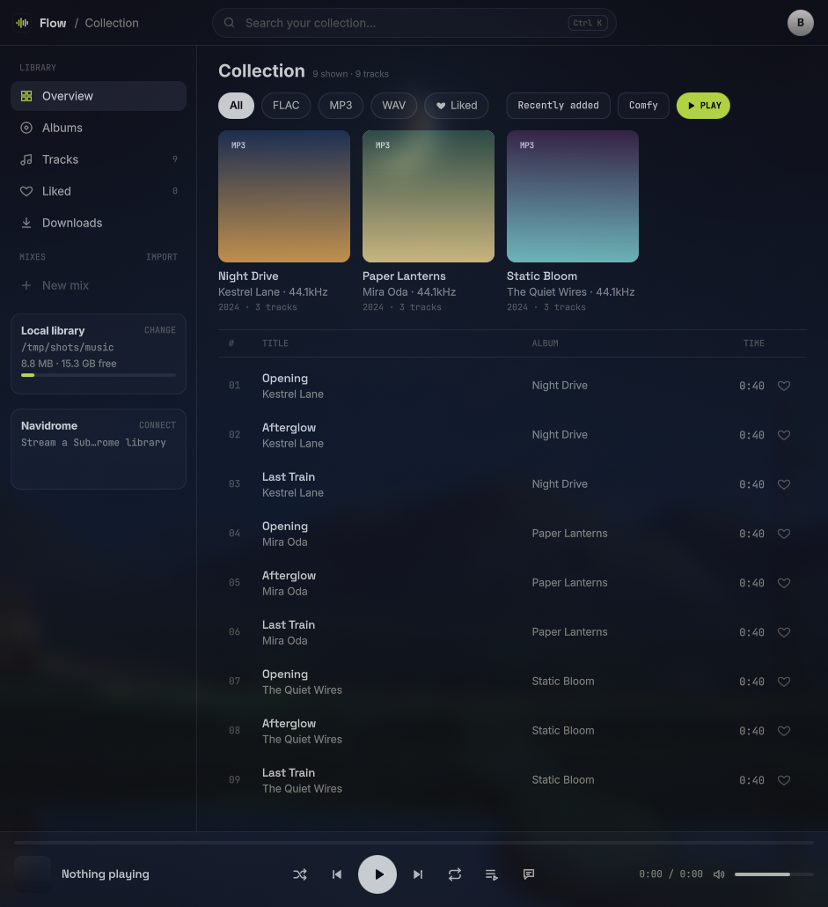

# Flow

A native Linux music player written in C++ and Qt 6 (QML). It plays local
FLAC, MP3 and WAV files, streams from a Navidrome / Subsonic server, and
ships a headless CLI. Built for Wayland (Hyprland), with a custom QML interface.



## Features

- **Library:** TagLib scan into SQLite, incremental rescans, folder watching,
  likes, embedded and folder cover art, search and format filters.
- **Playback:** `QMediaPlayer` (FFmpeg backend), seek, volume, audio device
  switching with hotplug and reconnect fallback, shuffle, repeat, play queue with
  drag-reorder, synced lyrics, saved queue on launch.
- **Mixes:** create, rename and reorder mixes; M3U import and export.
- **Visualizer:** live 48-band spectrum and oscilloscope in the now-playing panel.
- **Waveform and loudness:** cached per track in the index.
- **Full sound:** the decoded PCM runs through an EQ, RMS compression, a touch
  of stereo width and a limiter before it reaches the sound card. The dock's
  FULL chip A/Bs it against plain output.
- **Device sound profiles:** the tone stage follows the output device — built-in
  curves for the SteelSeries Arctis Pro (and GameDAC) and JLab JBuds Lux, with
  Auto matching by device name and a per-device manual override in the audio
  menu.
- **Navidrome:** browse and stream a Subsonic server. Nothing is copied to disk.
- **Downloads:** YouTube / YouTube Music links via `yt-dlp` (optional).
- **Metadata enrichment:** MusicBrainz and Cover Art Archive, stored in the
  index only. Audio files are never written to.
- **Themes:** 12 built-in looks (dark, light, and Windows-flavoured: Luna XP,
  Classic 95, Aero Glass, Fluent Mica, Blue Screen), picked from the Appearance
  card in the library rail. Remembered in `Flow.conf`.
- **MPRIS:** `playerctl`, Hyprland keybinds and shell widgets.
- **`flow-cli`:** headless front end for scanning, listing, mixes, downloads,
  devices and diagnostics.

## Build

Requires Qt 6 (base, declarative, multimedia with the FFmpeg backend, wayland),
TagLib, SQLite, CMake and Ninja. Verified with Qt 6.11.2.
MPRIS (media keys, playerctl, the desktop's media widget) needs Qt's D-Bus module.
It is on by default on Linux; add `-DFLOW_MPRIS=OFF` to build without it.

```sh
cmake -S . -B build-release -G Ninja -DCMAKE_BUILD_TYPE=Release
cmake --build build-release
ctest --test-dir build-release
```

Per-user install with no sudo, which adds the app to the launcher:

```sh
cmake -S . -B build-release -G Ninja -DCMAKE_BUILD_TYPE=Release -DCMAKE_INSTALL_PREFIX=$HOME/.local
cmake --build build-release
cmake --install build-release
```

### Flatpak

`packaging/flatpak/io.github.SamiulH25.Flow.yml` builds a sandboxed bundle on the
KDE 6.10 runtime, so it runs on any distro with Flatpak, whatever Qt it ships.
Build into your home directory: the builder's own `/tmp` is private to it.

```sh
flatpak install --user flathub org.kde.Platform//6.10 org.kde.Sdk//6.10 org.flatpak.Builder
flatpak run org.flatpak.Builder --force-clean --user \
    --repo=$HOME/flow-flatpak/repo $HOME/flow-flatpak/build packaging/flatpak/io.github.SamiulH25.Flow.yml
flatpak build-update-repo $HOME/flow-flatpak/repo
flatpak remote-add --user --if-not-exists --no-gpg-verify flow-local file://$HOME/flow-flatpak/repo
flatpak install --user flow-local io.github.SamiulH25.Flow
flatpak run io.github.SamiulH25.Flow
```

The bundle has ffmpeg (from the runtime) but not yt-dlp, and the sandbox cannot use a
host install of yt-dlp. YouTube downloads therefore do not work in the Flatpak build.

## Run

```sh
flow --library ~/Music      # the folder is remembered; default is ~/Music
flow --help
flow-cli list --json        # headless: scan, list, mixes, doctor, download
```

Index: `~/.local/share/Flow/Flow/library.db`. Settings and the saved queue:
`~/.config/Flow/Flow.conf`.

## Design

`STACK.md` records the technology choices and the scaling rules. The clickable
design specs are `ui-demo.html` and `ui-demo-console.html`. Serve them with
`python3 -m http.server 8100 --bind 127.0.0.1` from the repo root.
